<h1>
  <a href="#">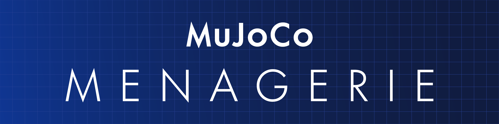</a>
</h1>

<p>
  <a href="https://github.com/google-deepmind/mujoco_menagerie/actions/workflows/build.yml?query=branch%3Amain" alt="GitHub Actions">
    
  </a>
  <a href="https://mujoco.readthedocs.io/en/latest/models.html" alt="Documentation">
    
  </a>
  <a href="https://pypi.org/project/mujoco-menagerie/" alt="PyPI">
    
  </a>
  <a href="https://github.com/google-deepmind/mujoco_menagerie/blob/main/CONTRIBUTING.md">
    
  </a>
</p>

<p align="center">
  <a href="README.md">English</a> · <b>简体中文</b>
</p>

**Menagerie** 是由 Google DeepMind 精选维护的高质量物理仿真模型库，专为 [MuJoCo](https://github.com/google-deepmind/mujoco) 物理引擎量身打造。

物理仿真器的表现取决于其仿真的模型质量。在像 MuJoCo 这样功能强大且包含丰富建模选项的物理引擎中，很容易构建出行为不及预期的“低质”模型。本模型库的核心目标，是为科研与工程社区提供经过精心设计与严格验证的高水准模型集合，确保开箱即用。

- [快速上手](#快速上手)
  - [前置条件](#前置条件)
  - [模型目录结构概览](#模型目录结构概览)
  - [使用指南](#使用指南)
- [Python 工具包](#python-工具包)
- [模型质量分级与贡献](#模型质量分级与贡献)
  - [贡献者快速配置](#贡献者快速配置)
- [Menagerie 模型库](#menagerie-模型库)
- [论文引用](#论文引用)
- [致谢](#致谢)
- [更新日志](#更新日志)
- [许可证与免责声明](#许可证与免责声明)

## 快速上手

### 前置条件

每个模型所需的最低 MuJoCo 版本均在其各自的 README 中明确注明。您可以从 GitHub [Releases 页面](https://github.com/google-deepmind/mujoco/releases/) 下载 MuJoCo 的预编译二进制文件；如果您使用 Python 进行开发，可以通过 `pip install mujoco` 从 [PyPI](https://pypi.org/project/mujoco/) 安装原生绑定。其他安装方式请参见 [MuJoCo 安装指南](https://github.com/google-deepmind/mujoco#installation)。

### 模型目录结构概览

Menagerie 的目录组织结构如下图所示。为简明起见，此处仅以单个模型目录为例，所有其他模型均遵循完全一致的目录规范：

```bash
├── unitree_go2
│   ├── assets
│   │   ├── base_0.obj
│   │   ├── ...
│   ├── go2.png
│   ├── go2.xml
│   ├── LICENSE
│   ├── README.md
│   └── scene.xml
│   └── go2_mjx.xml
│   └── scene_mjx.xml
```

- `assets`：存储用于视觉渲染和碰撞检测的模型 3D 网格文件（.stl 或 .obj）
- `LICENSE`：说明该模型的版权所有者与开源许可证条款
- `README.md`：包含详细说明该模型的 MJCF XML 文件生成流程与步骤
- `<model>.xml`：包含该模型的纯净 MJCF 定义
- `scene.xml`：引入 `<model>.xml`，并包含地面（plane）、光源（light source）以及其他场景实体
- `<model>.png`：`scene.xml` 渲染效果的 PNG 预览图
- `<model>_mjx.xml`：包含该模型兼容 MJX（JAX 硬件加速版 MuJoCo）的定义文件（部分模型提供）
- `scene_mjx.xml`：功能同 `scene.xml`，但加载对应的 MJX 变体模型

请注意，`<model>.xml` 仅描述机器人模型本体，其运动学树（kinematic tree）中不包含任何外部环境实体。我们将额外的场景环境定义置于 `scene.xml` 文件中，例如 Shadow Hand 的 [`scene.xml`](shadow_hand/scene_right.xml)。

### 使用指南

使用 [Python 工具包](#python-工具包) 是从 Python 中调用 Menagerie 最便捷的方式。您也可以将本代码库克隆至您指定的本地目录：

```bash
git clone https://github.com/google-deepmind/mujoco_menagerie.git
```

并使用 Python 可视化交互查看器（Viewer）交互式探索模型：

```bash
python -m mujoco.viewer --mjcf mujoco_menagerie/unitree_go2/scene.xml
```

Menagerie 中的模型亦可通过第三方开源库 [`robot_descriptions`](https://github.com/robot-descriptions/robot_descriptions.py) 获取使用。

如有其他疑问，请参阅我们的[常见问题解答 (FAQ)](FAQ.md)。

## Python 工具包

```bash
pip install mujoco-menagerie
```

```python
import mujoco_menagerie as mm

model = mm.load('unitree_go2')  # 首次调用自动下载，编译 scene.xml
spec = mm.get('unitree_go2').spec()  # 获取可编辑的 mujoco.MjSpec
```

每个模型在首次加载时会自动下载至每用户的本地缓存目录中，并且 `mujoco-menagerie==2026.9.0` 会将每个模型版本锁定至该发布版本。若要在未安装任何依赖的情况下直接从命令行查看模型：

```bash
uvx mujoco-menagerie view unitree_go2
```

完整 API 说明请参阅 [`python/DOC.md`](python/DOC.md)。

## 模型质量分级与贡献

我们的终极目标是使 Menagerie 中的所有模型尽可能真实地忠于其现实实体。提高模型保真度是一项持续推进的工作，目前许多模型的精度仍有很大提升空间。

然而，通过以当前形态开源 Menagerie，我们希望整合社区力量并提高社区贡献的能见度。为了帮助用户对每个模型的精确度建立合理预期，我们引入了以下质量分级体系：

| 等级 | 说明 |
|---|---|
| A+ | 数值完全源自严谨的系统辨识（System Identification）测定 |
| A | 数值符合物理现实，但尚未经过严谨的系统辨识 |
| B | 仿真稳定运行，但部分物理参数存在不切实际的偏差 |
| C | 属于条件稳定，具备显著的改进优化空间 |

一旦我们完成系统辨识工具箱的开发，该分级标准将应用于每个模型。我们目前计划在今年晚些时候发布该工具箱。

关于如何为本项目贡献模型（例如向 Menagerie 添加新模型），请参阅 [贡献指南 (CONTRIBUTING)](CONTRIBUTING.md)。

### 贡献者快速配置

只需两条命令即可完成开发环境初始化，唯一的前置依赖是安装 [`uv`](https://docs.astral.sh/uv/)：

```bash
make install   # 一次性安装：安装 pre-commit 与 git 钩子
make all       # 运行 CI 的所有检查（代码风格 + 格式化 + 许可证 + XML + 单元测试）
```

完成 `make install` 后，轻量级检查将在每次 `git commit` 时自动触发。在推送提交前，请运行 `make all`。完整开发流程请参阅 [CONTRIBUTING.md](CONTRIBUTING.md)。

## Menagerie 模型库

> 点击下方任意模型缩略图，即可在由 [live.mujoco.org](https://live.mujoco.org) 强力驱动的网页端 MuJoCo 查看器中在线交互预览模型。

<!-- BEGIN MODELS (auto-generated by `make gallery` — do not edit) -->

**人形机器人 (Humanoids)**

| 预览 | 名称 | 自由度 (DoFs) | 许可证 |
|:---:|---|---|---|
| <a href='https://live.mujoco.org/?model=github:google-deepmind/mujoco_menagerie/main/unitree_h1/scene.xml' title='Open live preview for Unitree H1'>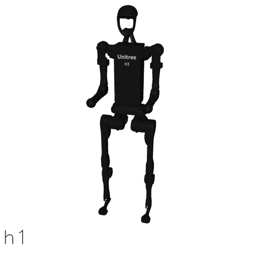</a> | Unitree H1 | 19 | [BSD-3-Clause](unitree_h1/LICENSE) |
| <a href='https://live.mujoco.org/?model=github:google-deepmind/mujoco_menagerie/main/robotis_op3/scene.xml' title='Open live preview for Robotis OP3'>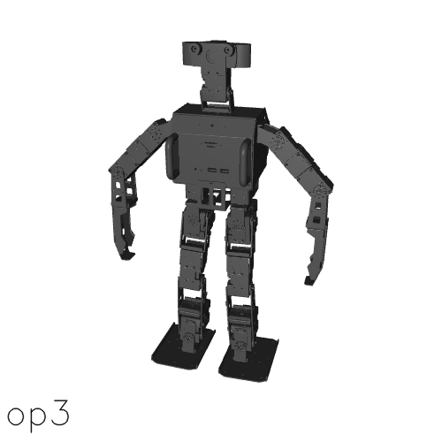</a> | Robotis OP3 | 20 | [Apache-2.0](robotis_op3/LICENSE) |
| <a href='https://live.mujoco.org/?model=github:google-deepmind/mujoco_menagerie/main/unitree_g1/scene.xml' title='Open live preview for Unitree G1'>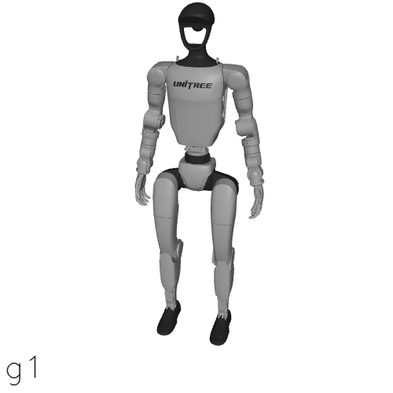</a> | Unitree G1 | 29 | [BSD-3-Clause](unitree_g1/LICENSE) |
| <a href='https://live.mujoco.org/?model=github:google-deepmind/mujoco_menagerie/main/pal_talos/scene_position.xml' title='Open live preview for TALOS'>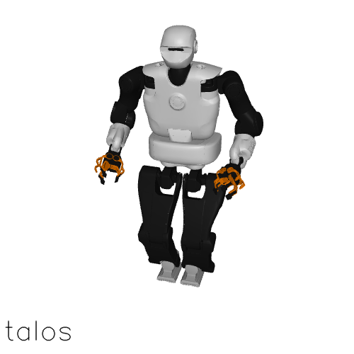</a> | TALOS | 44 | [Apache-2.0](pal_talos/LICENSE) |
| <a href='https://live.mujoco.org/?model=github:google-deepmind/mujoco_menagerie/main/booster_t1/scene.xml' title='Open live preview for Booster T1'>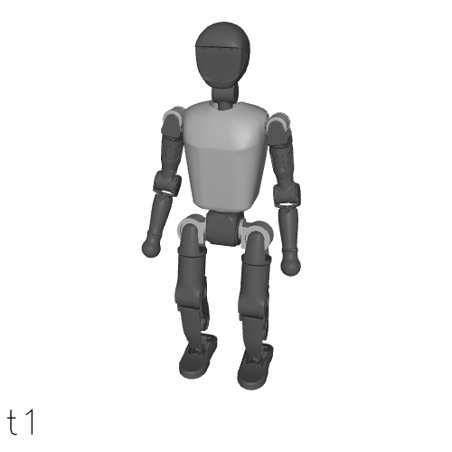</a> | Booster T1 | 23 | [Apache-2.0](booster_t1/LICENSE) |
| <a href='https://live.mujoco.org/?model=github:google-deepmind/mujoco_menagerie/main/toddlerbot_2xc/scene.xml' title='Open live preview for ToddlerBot 2XC'>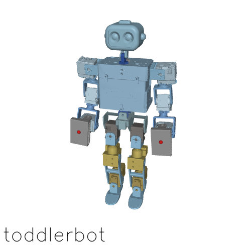</a> | ToddlerBot 2XC | 44 | [MIT](toddlerbot_2xc/LICENSE) |
| <a href='https://live.mujoco.org/?model=github:google-deepmind/mujoco_menagerie/main/pndbotics_adam_lite/scene.xml' title='Open live preview for PNDbotics Adam_lite'>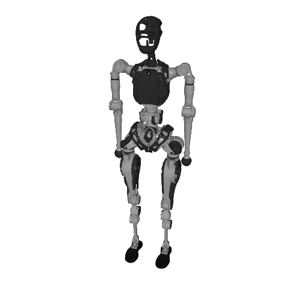</a> | PNDbotics Adam_lite | 25 | [MIT](pndbotics_adam_lite/LICENSE) |
| <a href='https://live.mujoco.org/?model=github:google-deepmind/mujoco_menagerie/main/apptronik_apollo/scene.xml' title='Open live preview for Apptronik Apollo'>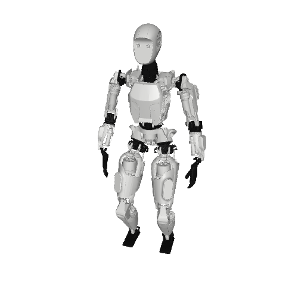</a> | Apptronik Apollo | 32 | [Apache-2.0](apptronik_apollo/LICENSE) |
| <a href='https://live.mujoco.org/?model=github:google-deepmind/mujoco_menagerie/main/berkeley_humanoid/scene.xml' title='Open live preview for Berkeley Humanoid'>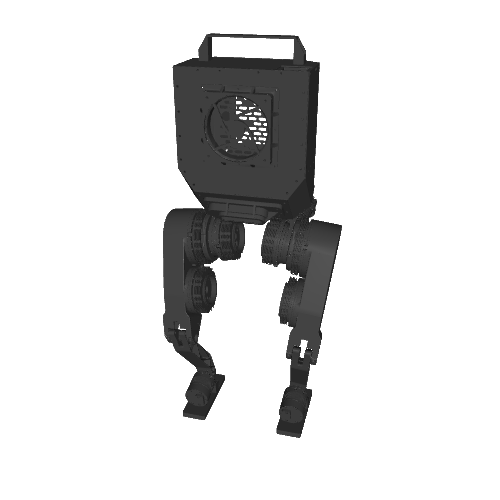</a> | Berkeley Humanoid | 12 | [BSD-3-Clause](berkeley_humanoid/LICENSE) |
| <a href='https://live.mujoco.org/?model=github:google-deepmind/mujoco_menagerie/main/fourier_n1/scene.xml' title='Open live preview for Fourier N1'>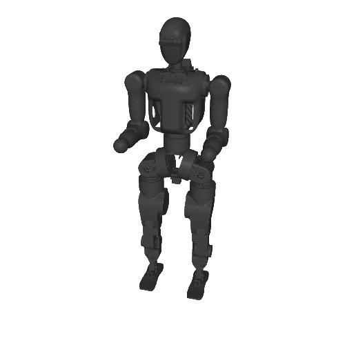</a> | Fourier N1 | 23 | [Apache-2.0](fourier_n1/LICENSE) |
| <a href='https://live.mujoco.org/?model=github:google-deepmind/mujoco_menagerie/main/toddlerbot_2xm/scene.xml' title='Open live preview for ToddlerBot 2XM'>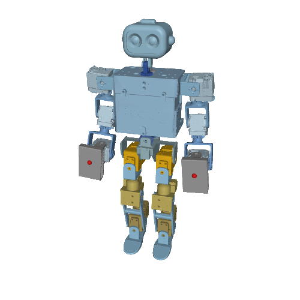</a> | ToddlerBot 2XM | 44 | [MIT](toddlerbot_2xm/LICENSE) |

**四足机器人 (Quadrupeds)**

| 预览 | 名称 | 自由度 (DoFs) | 许可证 |
|:---:|---|---|---|
| <a href='https://live.mujoco.org/?model=github:google-deepmind/mujoco_menagerie/main/unitree_a1/scene.xml' title='Open live preview for Unitree A1'>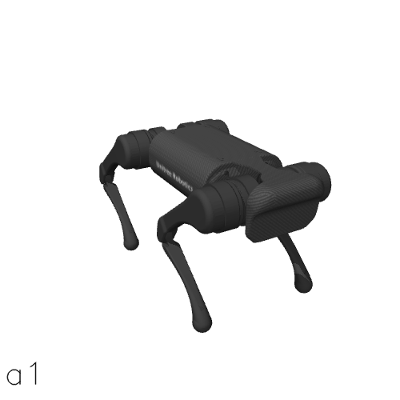</a> | Unitree A1 | 12 | [BSD-3-Clause](unitree_a1/LICENSE) |
| <a href='https://live.mujoco.org/?model=github:google-deepmind/mujoco_menagerie/main/google_barkour_v0/scene.xml' title='Open live preview for Google Barkour v0'>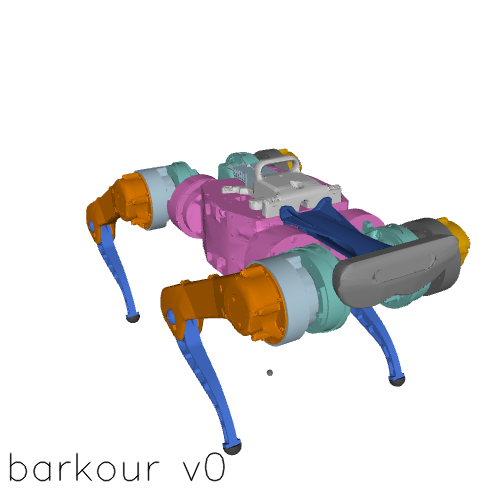</a> | Google Barkour v0 | 12 | [Apache-2.0](google_barkour_v0/LICENSE) |
| <a href='https://live.mujoco.org/?model=github:google-deepmind/mujoco_menagerie/main/anybotics_anymal_b/scene.xml' title='Open live preview for ANYmal B'>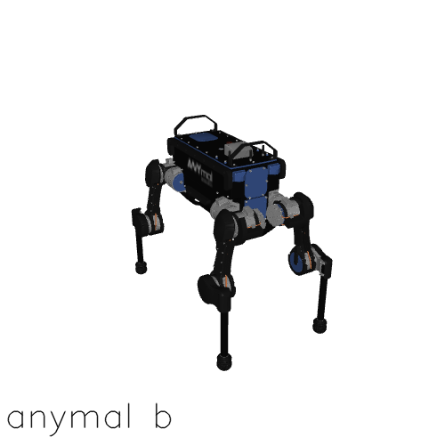</a> | ANYmal B | 12 | [BSD-3-Clause](anybotics_anymal_b/LICENSE) |
| <a href='https://live.mujoco.org/?model=github:google-deepmind/mujoco_menagerie/main/unitree_go1/scene.xml' title='Open live preview for Unitree Go1'>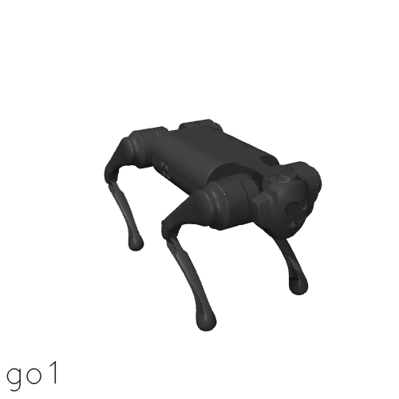</a> | Unitree Go1 | 12 | [BSD-3-Clause](unitree_go1/LICENSE) |
| <a href='https://live.mujoco.org/?model=github:google-deepmind/mujoco_menagerie/main/anybotics_anymal_c/scene.xml' title='Open live preview for ANYmal C'>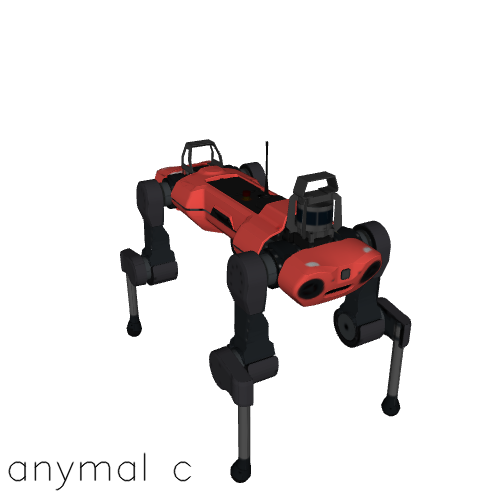</a> | ANYmal C | 12 | [BSD-3-Clause](anybotics_anymal_c/LICENSE) |
| <a href='https://live.mujoco.org/?model=github:google-deepmind/mujoco_menagerie/main/google_barkour_vb/scene.xml' title='Open live preview for Google Barkour vB'>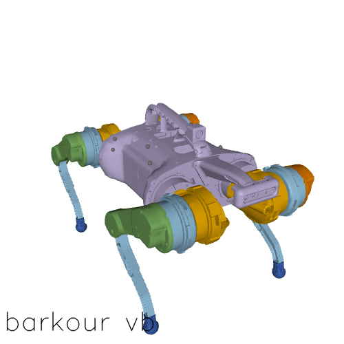</a> | Google Barkour vB | 12 | [Apache-2.0](google_barkour_vb/LICENSE) |
| <a href='https://live.mujoco.org/?model=github:google-deepmind/mujoco_menagerie/main/unitree_go2/scene.xml' title='Open live preview for Unitree Go2'>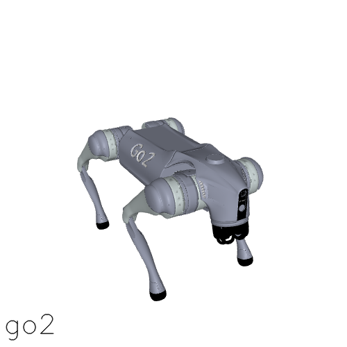</a> | Unitree Go2 | 12 | [BSD-3-Clause](unitree_go2/LICENSE) |
| <a href='https://live.mujoco.org/?model=github:google-deepmind/mujoco_menagerie/main/boston_dynamics_spot/scene.xml' title='Open live preview for Boston Dynamics Spot'>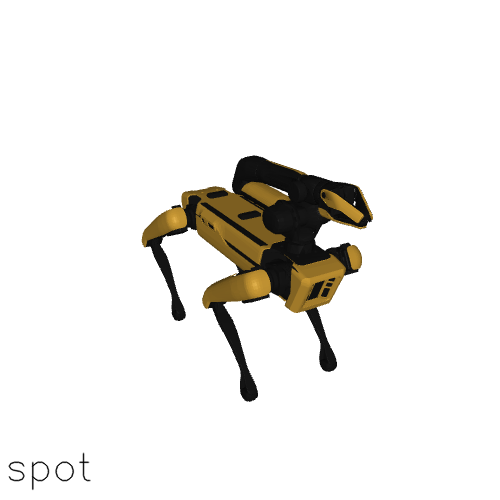</a> | Boston Dynamics Spot | 19 | [BSD-3-Clause](boston_dynamics_spot/LICENSE) |

**双足机器人 (Bipeds)**

| 预览 | 名称 | 自由度 (DoFs) | 许可证 |
|:---:|---|---|---|
| <a href='https://live.mujoco.org/?model=github:google-deepmind/mujoco_menagerie/main/agility_cassie/scene.xml' title='Open live preview for Agility Cassie'>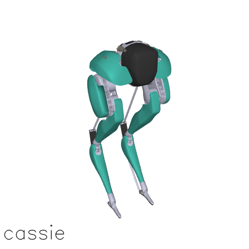</a> | Agility Cassie | 28 | [MIT](agility_cassie/LICENSE) |

**生物力学模型 (Biomechanical)**

| 预览 | 名称 | 自由度 (DoFs) | 许可证 |
|:---:|---|---|---|
| <a href='https://live.mujoco.org/?model=github:google-deepmind/mujoco_menagerie/main/flybody/scene.xml' title='Open live preview for Flybody'>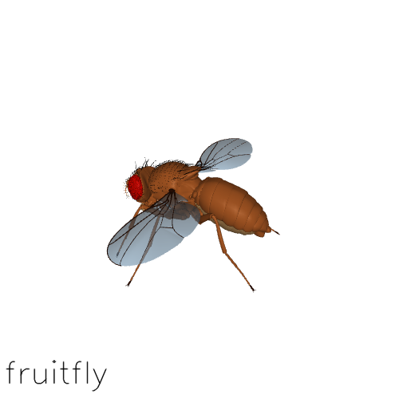</a> | Flybody | 102 | [Apache-2.0](flybody/LICENSE) |
| <a href='https://live.mujoco.org/?model=github:google-deepmind/mujoco_menagerie/main/iit_softfoot/scene.xml' title='Open live preview for IIT SoftFoot'>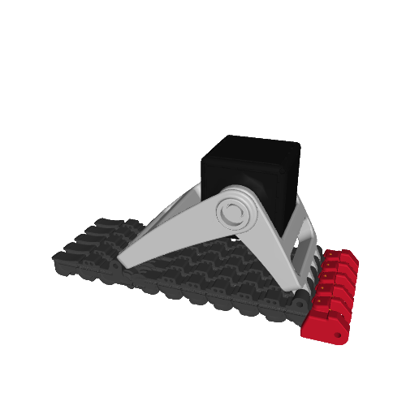</a> | IIT SoftFoot | 92 | [BSD-3-Clause](iit_softfoot/LICENSE) |
| <a href='https://live.mujoco.org/?model=github:google-deepmind/mujoco_menagerie/main/ms_human_700/scene.xml' title='Open live preview for MS-Human-700'>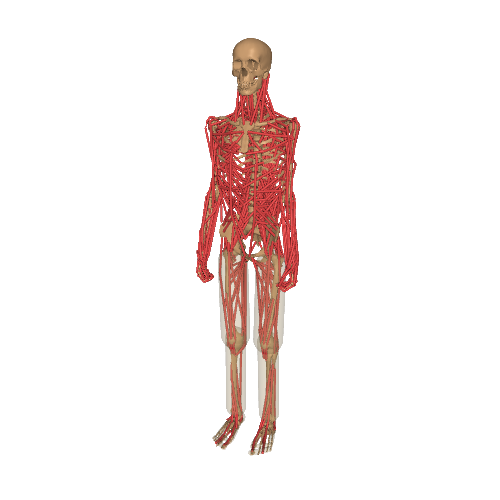</a> | MS-Human-700 | 85 | [Apache-2.0](ms_human_700/LICENSE) |

**双臂机器人 (Dual Arms)**

| 预览 | 名称 | 自由度 (DoFs) | 许可证 |
|:---:|---|---|---|
| <a href='https://live.mujoco.org/?model=github:google-deepmind/mujoco_menagerie/main/aloha/scene.xml' title='Open live preview for ALOHA'>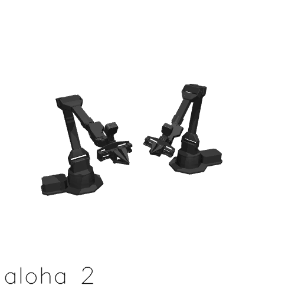</a> | ALOHA | 16 | [BSD-3-Clause](aloha/LICENSE) |

**移动操作机器人 (Mobile Manipulators)**

| 预览 | 名称 | 自由度 (DoFs) | 许可证 |
|:---:|---|---|---|
| <a href='https://live.mujoco.org/?model=github:google-deepmind/mujoco_menagerie/main/google_robot/scene.xml' title='Open live preview for Google Robot'>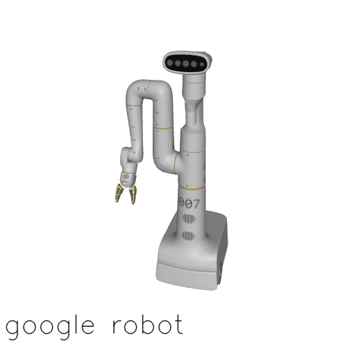</a> | Google Robot | 9 | [Apache-2.0](google_robot/LICENSE) |
| <a href='https://live.mujoco.org/?model=github:google-deepmind/mujoco_menagerie/main/hello_robot_stretch/scene.xml' title='Open live preview for Hello Robot Stretch 2'>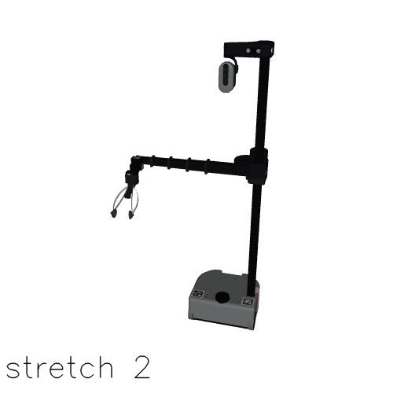</a> | Hello Robot Stretch 2 | 17 | [BSD-3-Clause-Clear](hello_robot_stretch/LICENSE) |
| <a href='https://live.mujoco.org/?model=github:google-deepmind/mujoco_menagerie/main/stanford_tidybot/scene.xml' title='Open live preview for Stanford TidyBot'>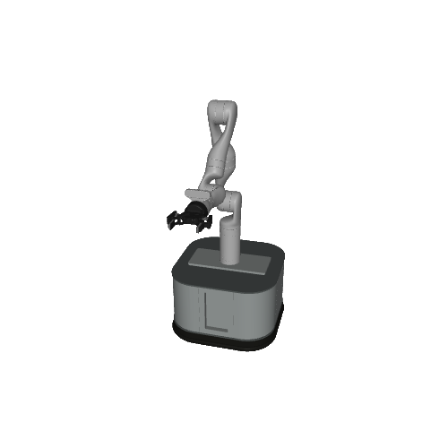</a> | Stanford TidyBot | 18 | [MIT](stanford_tidybot/LICENSE) |
| <a href='https://live.mujoco.org/?model=github:google-deepmind/mujoco_menagerie/main/hello_robot_stretch_3/scene.xml' title='Open live preview for Hello Robot Stretch 3'>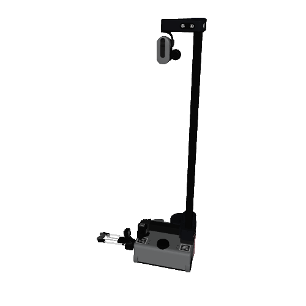</a> | Hello Robot Stretch 3 | 20 | [Apache-2.0](hello_robot_stretch_3/LICENSE) |
| <a href='https://live.mujoco.org/?model=github:google-deepmind/mujoco_menagerie/main/pal_tiago/scene_position.xml' title='Open live preview for TIAGo'>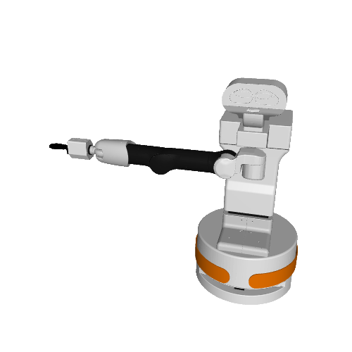</a> | TIAGo | 22 | [Apache-2.0](pal_tiago/LICENSE) |
| <a href='https://live.mujoco.org/?model=github:google-deepmind/mujoco_menagerie/main/pal_tiago_dual/scene_position.xml' title='Open live preview for TIAGo++'>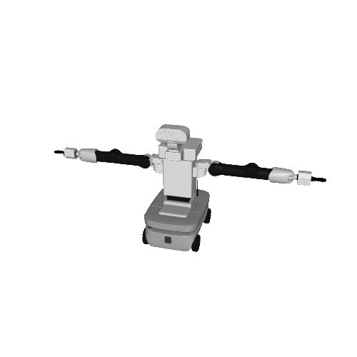</a> | TIAGo++ | 25 | [Apache-2.0](pal_tiago_dual/LICENSE) |
| <a href='https://live.mujoco.org/?model=github:google-deepmind/mujoco_menagerie/main/rainbow_robotics_rby1/scene_rby1a_1.2.xml' title='Open live preview for Rainbow Robotics RBY1'>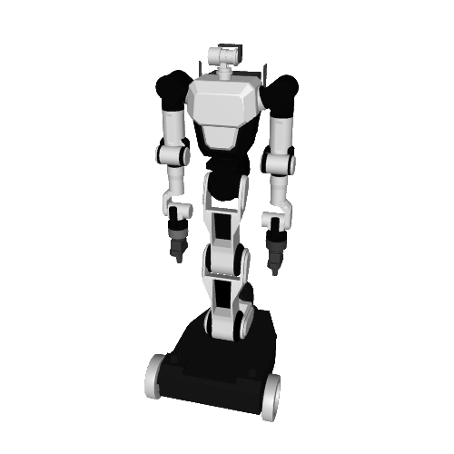</a> | Rainbow Robotics RBY1 | 28 | [Apache-2.0](rainbow_robotics_rby1/LICENSE) |

**无人机 (Drones)**

| 预览 | 名称 | 自由度 (DoFs) | 许可证 |
|:---:|---|---|---|
| <a href='https://live.mujoco.org/?model=github:google-deepmind/mujoco_menagerie/main/skydio_x2/scene.xml' title='Open live preview for Skydio X2'>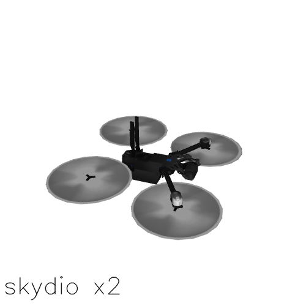</a> | Skydio X2 | 0 | [Apache-2.0](skydio_x2/LICENSE) |
| <a href='https://live.mujoco.org/?model=github:google-deepmind/mujoco_menagerie/main/bitcraze_crazyflie_2/scene.xml' title='Open live preview for Bitcraze Crazyflie 2'>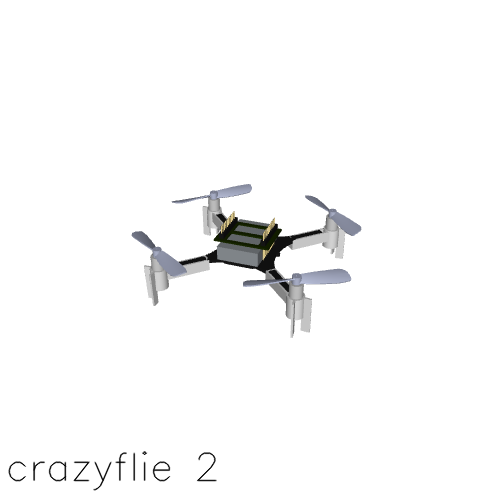</a> | Bitcraze Crazyflie 2 | 0 | [MIT](bitcraze_crazyflie_2/LICENSE) |

**机械臂 (Arms)**

| 预览 | 名称 | 自由度 (DoFs) | 许可证 |
|:---:|---|---|---|
| <a href='https://live.mujoco.org/?model=github:google-deepmind/mujoco_menagerie/main/franka_emika_panda/scene.xml' title='Open live preview for Franka Emika Panda'>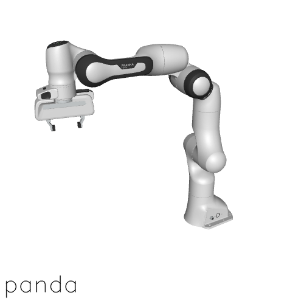</a> | Franka Emika Panda | 9 | [Apache-2.0](franka_emika_panda/LICENSE) |
| <a href='https://live.mujoco.org/?model=github:google-deepmind/mujoco_menagerie/main/franka_fr3/scene.xml' title='Open live preview for Franka Robotics FR3'>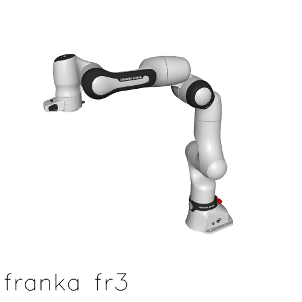</a> | Franka Robotics FR3 | 7 | [Apache-2.0](franka_fr3/LICENSE) |
| <a href='https://live.mujoco.org/?model=github:google-deepmind/mujoco_menagerie/main/ufactory_lite6/scene.xml' title='Open live preview for Lite 6'>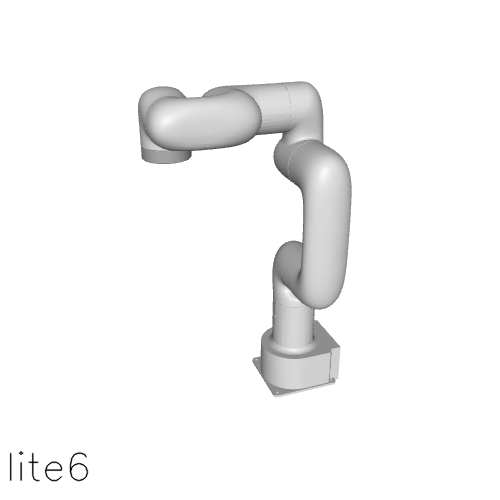</a> | Lite 6 | 6 | [BSD-3-Clause](ufactory_lite6/LICENSE) |
| <a href='https://live.mujoco.org/?model=github:google-deepmind/mujoco_menagerie/main/unitree_z1/scene.xml' title='Open live preview for Unitree Z1'>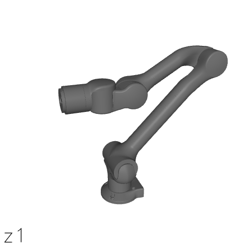</a> | Unitree Z1 | 6 | [BSD-3-Clause](unitree_z1/LICENSE) |
| <a href='https://live.mujoco.org/?model=github:google-deepmind/mujoco_menagerie/main/universal_robots_ur5e/scene.xml' title='Open live preview for Universal Robots UR5e'>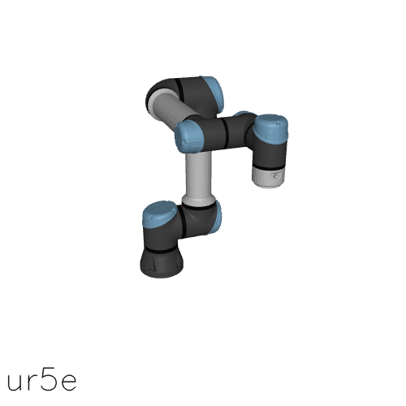</a> | Universal Robots UR5e | 6 | [BSD-3-Clause](universal_robots_ur5e/LICENSE) |
| <a href='https://live.mujoco.org/?model=github:google-deepmind/mujoco_menagerie/main/rethink_robotics_sawyer/scene.xml' title='Open live preview for Rethink Robotics Sawyer'>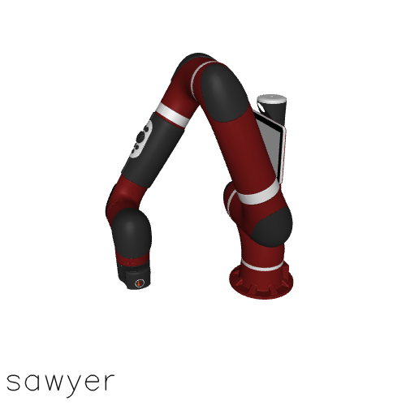</a> | Rethink Robotics Sawyer | 7 | [Apache-2.0](rethink_robotics_sawyer/LICENSE) |
| <a href='https://live.mujoco.org/?model=github:google-deepmind/mujoco_menagerie/main/robotis_omy_3m/scene.xml' title='Open live preview for ROBOTIS OMY-3M'>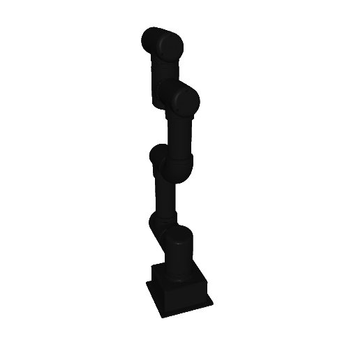</a> | ROBOTIS OMY-3M | 6 | [Apache-2.0](robotis_omy_3m/LICENSE) |
| <a href='https://live.mujoco.org/?model=github:google-deepmind/mujoco_menagerie/main/universal_robots_ur10e/scene.xml' title='Open live preview for Universal Robots UR10e'>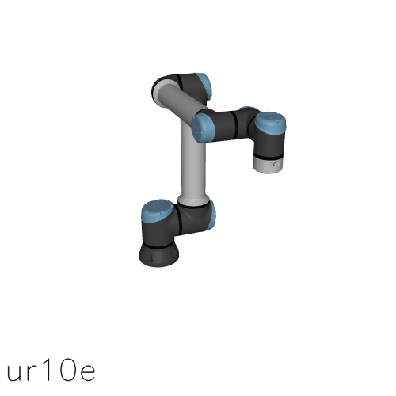</a> | Universal Robots UR10e | 6 | [BSD-3-Clause](universal_robots_ur10e/LICENSE) |
| <a href='https://live.mujoco.org/?model=github:google-deepmind/mujoco_menagerie/main/kuka_iiwa_14/scene.xml' title='Open live preview for KUKA LBR iiwa 14'>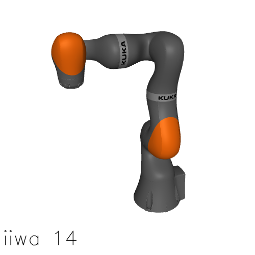</a> | KUKA LBR iiwa 14 | 7 | [BSD-3-Clause](kuka_iiwa_14/LICENSE) |
| <a href='https://live.mujoco.org/?model=github:google-deepmind/mujoco_menagerie/main/trossen_vx300s/scene.xml' title='Open live preview for ViperX 300 6DOF'>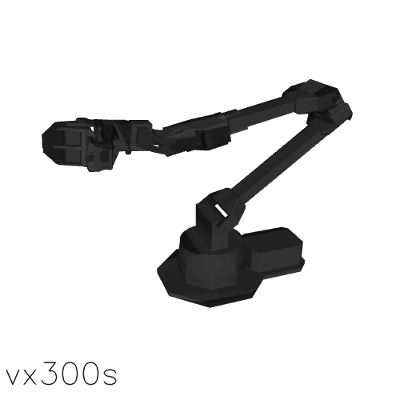</a> | ViperX 300 6DOF | 8 | [BSD-3-Clause](trossen_vx300s/LICENSE) |
| <a href='https://live.mujoco.org/?model=github:google-deepmind/mujoco_menagerie/main/ufactory_xarm7/scene.xml' title='Open live preview for xArm7'>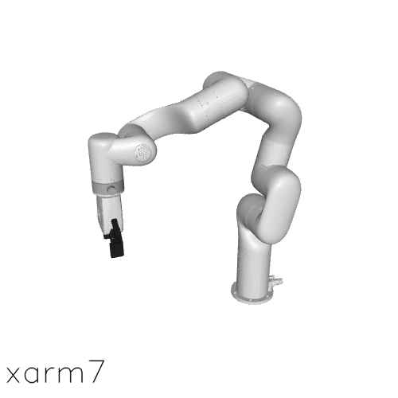</a> | xArm7 | 13 | [BSD-3-Clause](ufactory_xarm7/LICENSE) |
| <a href='https://live.mujoco.org/?model=github:google-deepmind/mujoco_menagerie/main/kinova_gen3/scene.xml' title='Open live preview for Kinova Gen3'>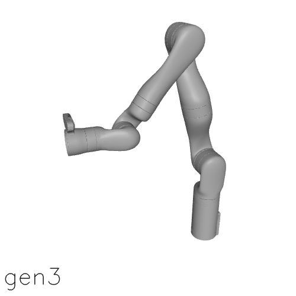</a> | Kinova Gen3 | 7 | [BSD-3-Clause](kinova_gen3/LICENSE) |
| <a href='https://live.mujoco.org/?model=github:google-deepmind/mujoco_menagerie/main/agilex_piper/scene.xml' title='Open live preview for AgileX PiPER'>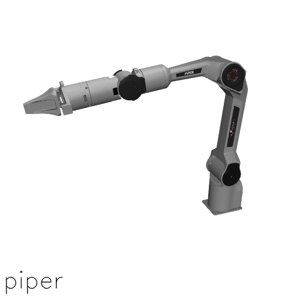</a> | AgileX PiPER | 8 | [MIT](agilex_piper/LICENSE) |
| <a href='https://live.mujoco.org/?model=github:google-deepmind/mujoco_menagerie/main/flexiv_rizon4/scene.xml' title='Open live preview for Flexiv Robotics Rizon4'>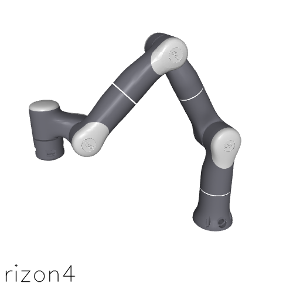</a> | Flexiv Robotics Rizon4 | 7 | [Apache-2.0](flexiv_rizon4/LICENSE) |
| <a href='https://live.mujoco.org/?model=github:google-deepmind/mujoco_menagerie/main/arx_l5/scene.xml' title='Open live preview for ARX L5'>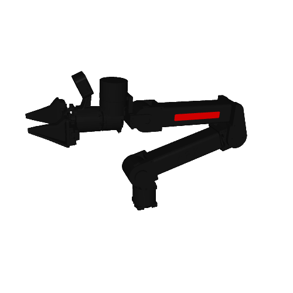</a> | ARX L5 | 8 | [BSD-3-Clause](arx_l5/LICENSE) |
| <a href='https://live.mujoco.org/?model=github:google-deepmind/mujoco_menagerie/main/flexiv_rizon4s/scene.xml' title='Open live preview for Flexiv Robotics Rizon4S'>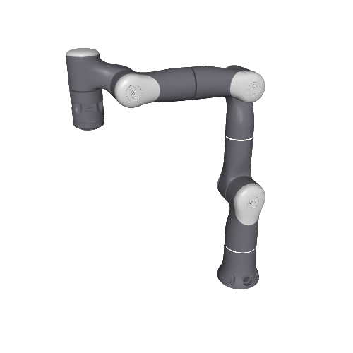</a> | Flexiv Robotics Rizon4S | 7 | [Apache-2.0](flexiv_rizon4s/LICENSE) |
| <a href='https://live.mujoco.org/?model=github:google-deepmind/mujoco_menagerie/main/trossen_wx250s/scene.xml' title='Open live preview for WidowX 250 6DOF'></a> | WidowX 250 6DOF | 8 | [BSD-3-Clause](trossen_wx250s/LICENSE) |
| <a href='https://live.mujoco.org/?model=github:google-deepmind/mujoco_menagerie/main/trs_so_arm100/scene.xml' title='Open live preview for Standard Open Arm-100 5DOF - Version 1.3'></a> | Standard Open Arm-100 5DOF - Version 1.3 | 6 | [Apache-2.0](trs_so_arm100/LICENSE) |
| <a href='https://live.mujoco.org/?model=github:google-deepmind/mujoco_menagerie/main/low_cost_robot_arm/scene.xml' title='Open live preview for Low-Cost Robot Arm'></a> | Low-Cost Robot Arm | 6 | [Apache-2.0](low_cost_robot_arm/LICENSE) |
| <a href='https://live.mujoco.org/?model=github:google-deepmind/mujoco_menagerie/main/i2rt_yam/scene.xml' title='Open live preview for Yet Another Manipulator (YAM)'></a> | Yet Another Manipulator (YAM) | 8 | [MIT](i2rt_yam/LICENSE) |
| <a href='https://live.mujoco.org/?model=github:google-deepmind/mujoco_menagerie/main/seeed_rebot_devarm/scene.xml' title='Open live preview for Seeed Studio reBot DevArm'></a> | Seeed Studio reBot DevArm | 8 | [MIT](seeed_rebot_devarm/LICENSE) |
| <a href='https://live.mujoco.org/?model=github:google-deepmind/mujoco_menagerie/main/dynamixel_2r/scene.xml' title='Open live preview for Dynamixel 2R'></a> | Dynamixel 2R | 2 | [MIT](dynamixel_2r/LICENSE) |
| <a href='https://live.mujoco.org/?model=github:google-deepmind/mujoco_menagerie/main/franka_fr3_v2/scene.xml' title='Open live preview for Franka Robotics FR3 v2'></a> | Franka Robotics FR3 v2 | 7 | [Apache-2.0](franka_fr3_v2/LICENSE) |
| <a href='https://live.mujoco.org/?model=github:google-deepmind/mujoco_menagerie/main/robotstudio_so101/scene.xml' title='Open live preview for The Robot Studio SO101'></a> | The Robot Studio SO101 | 6 | [Apache-2.0](robotstudio_so101/LICENSE) |
| <a href='https://live.mujoco.org/?model=github:google-deepmind/mujoco_menagerie/main/trossen_wxai/scene.xml' title='Open live preview for Trossen WXAI'></a> | Trossen WXAI | 8 | [BSD-3-Clause](trossen_wxai/LICENSE) |

**末端执行器 / 灵巧手 (End-effectors)**

| 预览 | 名称 | 自由度 (DoFs) | 许可证 |
|:---:|---|---|---|
| <a href='https://live.mujoco.org/?model=github:google-deepmind/mujoco_menagerie/main/franka_emika_panda/hand.xml' title='Open live preview for Panda Gripper'></a> | Panda Gripper | 2 | [Apache-2.0](franka_emika_panda/LICENSE) |
| <a href='https://live.mujoco.org/?model=github:google-deepmind/mujoco_menagerie/main/wonik_allegro/scene_left.xml' title='Open live preview for Allegro Hand V3'></a> | Allegro Hand V3 | 16 | [BSD-2-Clause](wonik_allegro/LICENSE) |
| <a href='https://live.mujoco.org/?model=github:google-deepmind/mujoco_menagerie/main/shadow_hand/scene_left.xml' title='Open live preview for Shadow Hand E3M5'></a> | Shadow Hand E3M5 | 24 | [Apache-2.0](shadow_hand/LICENSE) |
| <a href='https://live.mujoco.org/?model=github:google-deepmind/mujoco_menagerie/main/robotiq_2f85/scene.xml' title='Open live preview for Robotiq 2F-85'></a> | Robotiq 2F-85 | 8 | [BSD-2-Clause](robotiq_2f85/LICENSE) |
| <a href='https://live.mujoco.org/?model=github:google-deepmind/mujoco_menagerie/main/ufactory_xarm7/hand.xml' title='Open live preview for xarm7 Gripper'></a> | xarm7 Gripper | 6 | [BSD-3-Clause](ufactory_xarm7/LICENSE) |
| <a href='https://live.mujoco.org/?model=github:google-deepmind/mujoco_menagerie/main/shadow_dexee/scene.xml' title='Open live preview for Shadow DEX-EE Hand'></a> | Shadow DEX-EE Hand | 12 | [Apache-2.0](shadow_dexee/LICENSE) |
| <a href='https://live.mujoco.org/?model=github:google-deepmind/mujoco_menagerie/main/leap_hand/scene_left.xml' title='Open live preview for Leap Hand'></a> | Leap Hand | 16 | [MIT](leap_hand/LICENSE) |
| <a href='https://live.mujoco.org/?model=github:google-deepmind/mujoco_menagerie/main/umi_gripper/scene.xml' title='Open live preview for UMI-Gripper'></a> | UMI-Gripper | 8 | [MIT](umi_gripper/LICENSE) |
| <a href='https://live.mujoco.org/?model=github:google-deepmind/mujoco_menagerie/main/sharpa_wave/scene_left.xml' title='Open live preview for Sharpa Wave'></a> | Sharpa Wave | 22 | [Apache-2.0](sharpa_wave/LICENSE) |
| <a href='https://live.mujoco.org/?model=github:google-deepmind/mujoco_menagerie/main/robotiq_2f85_v4/scene.xml' title='Open live preview for Robotiq 2F-85 v4'></a> | Robotiq 2F-85 v4 | 6 | [BSD-2-Clause](robotiq_2f85_v4/LICENSE) |
| <a href='https://live.mujoco.org/?model=github:google-deepmind/mujoco_menagerie/main/tetheria_aero_hand_open/scene_right.xml' title='Open live preview for Tetheria Aero Hand Open'></a> | Tetheria Aero Hand Open | 16 | [Apache-2.0](tetheria_aero_hand_open/LICENSE) |

**移动底盘 (Mobile Bases)**

| 预览 | 名称 | 自由度 (DoFs) | 许可证 |
|:---:|---|---|---|
| <a href='https://live.mujoco.org/?model=github:google-deepmind/mujoco_menagerie/main/robot_soccer_kit/scene.xml' title='Open live preview for Robot soccer kit omnidirectional'></a> | Robot soccer kit omnidirectional | 64 | [MIT](robot_soccer_kit/LICENSE) |

**其他 / 杂项 (Miscellaneous)**

| 预览 | 名称 | 自由度 (DoFs) | 许可证 |
|:---:|---|---|---|
| <a href='https://live.mujoco.org/?model=github:google-deepmind/mujoco_menagerie/main/realsense_d435i/d435i.xml' title='Open live preview for Realsense D435i'></a> | Realsense D435i | 0 | [Apache-2.0](realsense_d435i/LICENSE) |

<!-- END MODELS -->

## 论文引用

如果您在科研工作中使用了 Menagerie，请使用以下格式进行引用：

```bibtex
@software{menagerie2022github,
  author = {Zakka, Kevin and Tassa, Yuval and {MuJoCo Menagerie Contributors}},
  title = {{MuJoCo Menagerie: A collection of high-quality simulation models for MuJoCo}},
  url = {http://github.com/google-deepmind/mujoco_menagerie},
  year = {2022},
}
```

## 致谢

本代码库中的模型构建于许多才华横溢的工程师与设计师所开源的第三方模型之上。没有他们慷慨无私的开源贡献，本项目的建立将无从谈起。在此向所有使 MuJoCo Menagerie 成为可能的机器人设计师与工程师致以崇高的敬意。

感谢 Pedro Vergani 在视觉效果与设计方面给予的大力协助。

将本代码库公开发布的核心开发工作由 [Kevin Zakka](https://kzakka.com/) 主导，并得到了 Google DeepMind 机器人仿真团队（Robotics Simulation Team）的全力支持。

本项目还受益于广泛开源社区成员的积极贡献——完整贡献者列表请参阅 [CONTRIBUTORS.md](./CONTRIBUTORS.md)。

## 更新日志

有关全库关键更新的综合概览，请参阅全局 [CHANGELOG.md](./CHANGELOG.md)。

每个单独的模型目录下亦包含其专属的 `CHANGELOG.md` 文件，详细记录该模型的历史修订，可直接从对应模型的 README 中跳转查阅。

## 许可证与免责声明

本代码库各个模型子目录中的 XML 文件和资产资源文件遵循不同的开源许可协议。请参阅各个特定模型子目录下的 `LICENSE` 文件以获取详细的许可证与版权信息。

除另有说明外，所有其他内容版权归 DeepMind Technologies Limited 所有（2022 年），并基于 Apache License 2.0 许可证授权。许可证副本请参阅根目录下的 `LICENSE` 文件，亦可访问 https://www.apache.org/licenses/LICENSE-2.0 获取。

本项目非 Google 官方正式支持的产品。

---
*注：本文档由社区志愿者维护（贡献者：[@JasonYeYuhe](https://github.com/JasonYeYuhe)），内容与英文官方文档保持同步（更新时间：2026年10月14日）。如有任何疑问或更新建议，欢迎提交 PR 或 Issue。*
