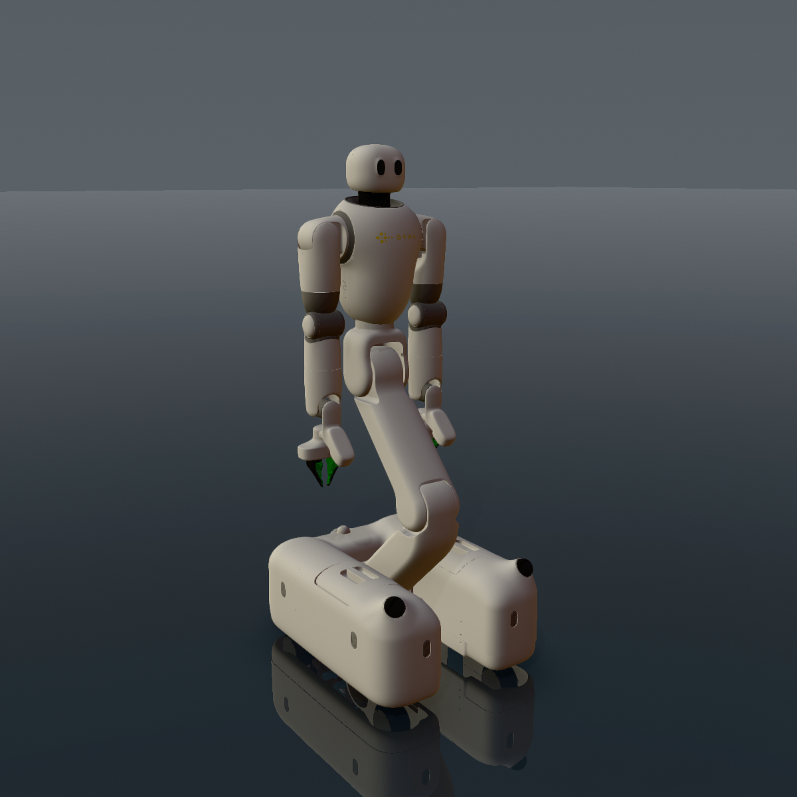

# dyna Taku Description (MJCF)

Tested with MuJoCo 3.3.7 and 3.4.1.

## Overview

This package contains a simplified MuJoCo model of **Taku**, a mobile dual-arm
robot developed by **dyna robotics**, with DynaClaw grippers.

The robot has four steered wheels, four waist joints, three head joints,
two seven-joint arms and parallel grippers, with 31 actuators.
Camera, lidar and IMU mounting frames are included.

Open `scene.xml` in MuJoCo; `taku.xml` contains the robot model and `home` keyframe.

## Derivation

Based on the existing MJCF model in
[dyna-robotics/dyna_robot_description at `afa6168`](https://github.com/dyna-robotics/dyna_robot_description/tree/afa6168/dyna_taku).
This package adapts that MJCF directly; it does not perform a new URDF conversion.

- Retain the source visual meshes, materials, physical link transforms, masses,
  inertias, joint limits and actuator force limits.
- Retain the source segmented DynaClaw collision meshes and finger coupling.
- Replace the solid base hull with separate convex hulls of the left, right and
  rear exterior shells plus the rear lidar, preserving the central U-shaped gap.
- Apply Menagerie XML formatting and defaults, inherit position control ranges
  from joint limits, and represent tool reference frames as sites.
- Adjust the `home` pose and position gains for stable initialization. These
  adjustments are simulation tuning, not measurements of the hardware. Folding
  position gains are `kp=5000`, `kv=200`; head-pitch gains are `kp=30`, `kv=1`.
  Hardware force limits are unchanged and no gravity compensation is assumed.

Joint `damping`, `armature` and `frictionloss` values are inherited from the source;
their measurement provenance is not documented here. Actuator `kp` and `kv` values
are inherited or manually tuned for simulation. None of these parameters is
claimed to be system-identified or validated against hardware measurements.

## License

Copyright (c) 2026 dyna robotics.

This model, including its meshes and texture, is released under the
[Apache License 2.0](LICENSE).
