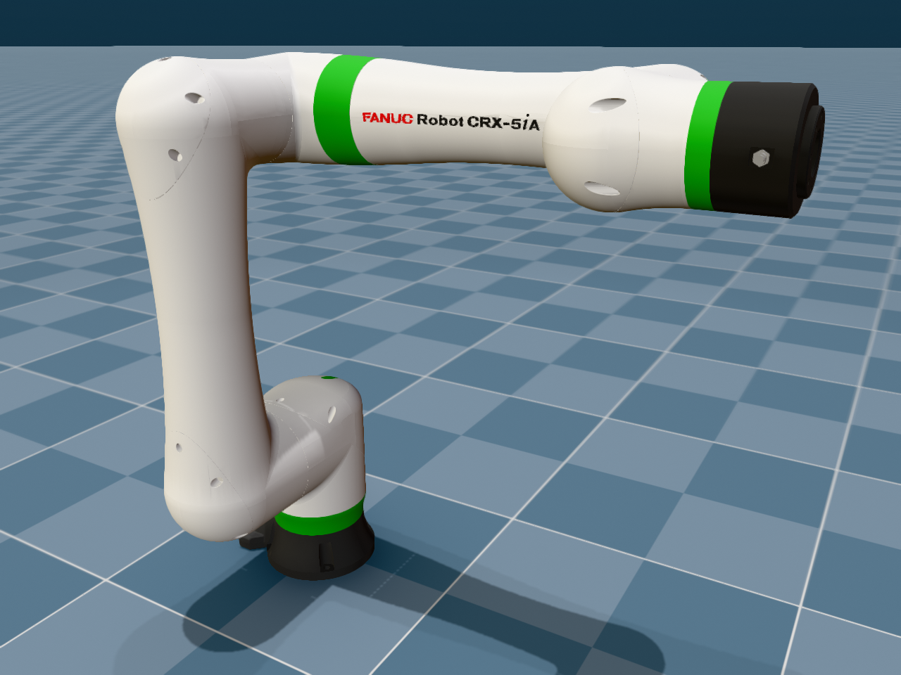

# FANUC CRX-5iA Description (MJCF)

> [!IMPORTANT]
> Requires MuJoCo 3.1.3 or later.

## Changelog

See [CHANGELOG.md](./CHANGELOG.md) for a full history of changes.

## Overview

This package contains a simplified robot description (MJCF) of the
[FANUC CRX-5iA](https://www.fanuc.eu/eu-en/product/robot/crx-5ia) 6-DoF
collaborative robot arm (5 kg payload, 994 mm reach). It is derived from
FANUC's publicly available
[`fanuc_description`](https://github.com/FANUC-CORPORATION/fanuc_description)
ROS 2 package (Apache-2.0).

  

## URDF → MJCF derivation steps

1. Expanded `fanuc_crx_description/robot/crx5ia.urdf.xacro` from
   [FANUC-CORPORATION/fanuc_description](https://github.com/FANUC-CORPORATION/fanuc_description)
   (tag `v2.3.0`, commit `fb40c9803a826ba68c7c8e28ba904a25efa7fcd2`) to a
   plain URDF (`xacro crx5ia.urdf.xacro`).
2. Converted the visual COLLADA (`.dae`) meshes to OBJ, splitting each mesh by
   material so that FANUC's white/green livery, dark joint covers, and the red
   J4 indicator are preserved as separate MuJoCo materials.
3. Added `<mujoco> <compiler meshdir="assets" discardvisual="false" fusestatic="false" balanceinertia="true"/> </mujoco>`
   to the URDF's `<robot>` clause in order to preserve visual geometries and
   `base_link`.
4. Loaded the URDF into MuJoCo and saved a corresponding MJCF.
5. Manually edited the MJCF to extract common properties into the `<default>`
   section, add a tracking light, enable `gravcomp="1"` on the moving link
   bodies, and add an `attachment_site` site on `J6_link` at the URDF `flange`
   frame.
6. Added position-controlled actuators using the URDF effort limits as
   `forcerange` (160 N·m for J1–J3, 40 N·m for J4–J6) and tuned joint
   `armature`, `damping`, and `frictionloss` for stable position control with
   `implicitfast`.
7. Added contact exclusions between `base_link` and `J1_link` (root body vs.
   first child), `base_link` and `J2_link`, and `J2_link` and `J4_link`.
8. Added a `home` keyframe (all joints at zero, i.e. the FANUC zero posture).
9. Added `scene.xml` which includes the robot, with a textured groundplane,
   skybox, and haze.

## License

This model is released under an [Apache-2.0 License](LICENSE).

The URDF, meshes, and inertial parameters are © 2025–2026 FANUC CORPORATION
and FANUC America Corporation, released under Apache-2.0 in
[FANUC-CORPORATION/fanuc_description](https://github.com/FANUC-CORPORATION/fanuc_description).
