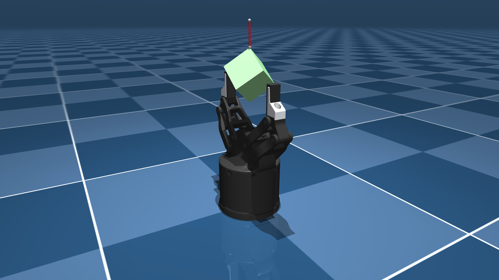

# Flexiv Robotics Grav Description (MJCF)

> [!IMPORTANT]
> Requires MuJoCo 3.0.0 or later.

## Changelog

See [CHANGELOG.md](./CHANGELOG.md) for a full history of changes.

## Overview

This package contains a robot description (MJCF) of the
[Grav (GN-01)](https://www.flexiv.com/product/grav) force-controlled two-finger
gripper developed by [Flexiv Robotics](https://www.flexiv.com/). It is derived
from the [publicly available URDF description](https://github.com/flexivrobotics/flexiv_description)
published by Flexiv. The gripper mounts directly on the flange of the Flexiv
Rizon arms: its `base` frame is the flange frame of the URDF, which is the
`attachment_site` of `flexiv_rizon4s`.

  

## URDF → MJCF derivation steps

1. Started from `urdf/common/grav_macro.xacro` of `flexiv_description` (commit
   SHA 8b8452105c5faf088f456db18b0e2581b16fc630) and expanded it with `xacro`.
2. Made the gripper base the root link and dropped the virtual
   `finger_width_joint` and its `<mimic>` tags, which MuJoCo does not support.
3. Loaded the URDF into MuJoCo and saved a corresponding MJCF.
4. Extracted common properties into the `<default>` section and baked the 90
   degree mesh rotation of the URDF into the mesh `refquat`.
5. Split the multi-group `finger_tip.obj` into the rubber pad and the aluminum
   holder, since MuJoCo only loads the first group of an OBJ file, and rotated
   the `finger_mount` visual geom by -1.86 degrees about its pivot, see
   [Known issues](#known-issues).
6. Derived the link masses from the visual mesh volumes at the density of their
   material (aluminum for the bars, finger mounts and finger tip holders,
   rubber for the pads) and assigned the remaining mass of the 1.186 kg total
   of the URDF to the base. Inertias assume a uniform mass distribution, the
   base over its collision hull.
7. Added two box pads with higher friction and priority to each finger tip.
8. Added the URDF TCP frames as sites (`grav_tcp`, `closed_fingers_tcp`,
   `left_finger_tcp`, `right_finger_tcp`).
9. Added `<exclude>` clauses to prevent collisions between the linkage bodies.
10. Replaced the URDF `<mimic>` tags by joint equality constraints.
11. Added a tendon that splits the actuation between both knuckle joints and a
    position actuator whose control input is the finger opening width in meters
    (0 closed, 0.1 open), using the width to knuckle angle mapping of the URDF.
12. Added `impratio=10` and elliptic friction cones for better noslip.
13. Added `scene.xml` which includes the gripper, with a textured groundplane,
    skybox, and haze and a hanging box.

## Known issues

- **`finger_tip.obj` groups.** The upstream OBJ holds the rubber pad and the
  aluminum holder as separate groups, of which MuJoCo only loads the first.
  The file is split into one mesh per part with unchanged vertices (step 5).
- **`finger_mount.stl` orientation.** The upstream mesh is rotated by 1.86
  degrees about the outer bar pivot relative to the URDF joint frames. Since
  the URDF kinematics are consistent, only the visual geom is rotated back
  (step 5); mesh file, collision geometry and frames are those of the URDF.
- **Masses.** The URDF only specifies a total mass of 1.186 kg on the base
  link (Flexiv's datasheet lists 0.9 kg). Link masses and inertias are
  estimated from the meshes (step 6).

## License

This model is released under an [Apache-2.0 License](LICENSE).
