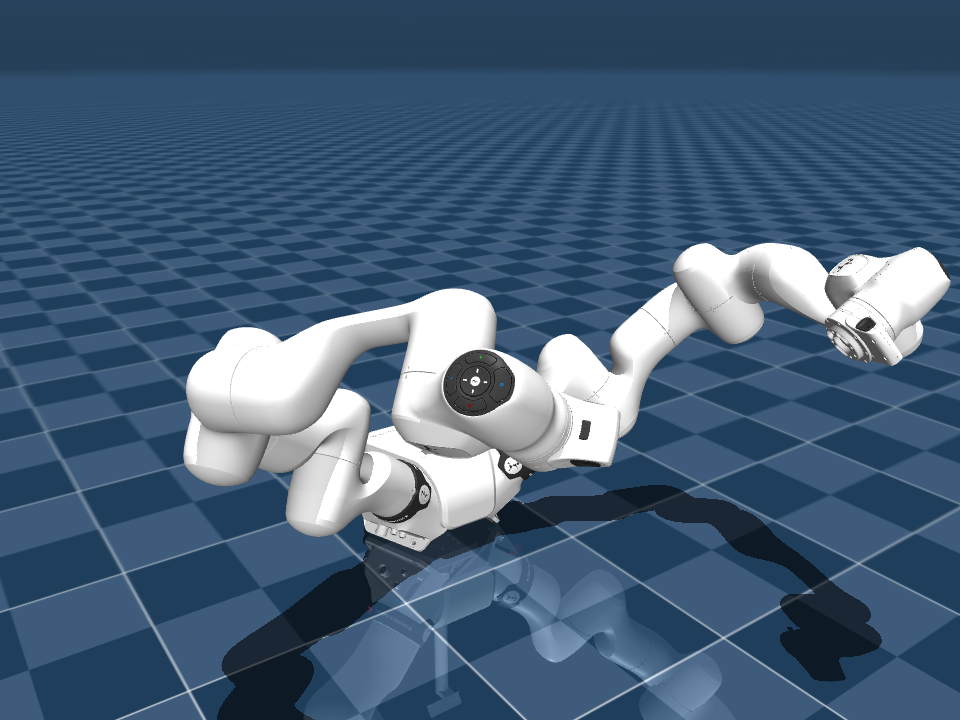
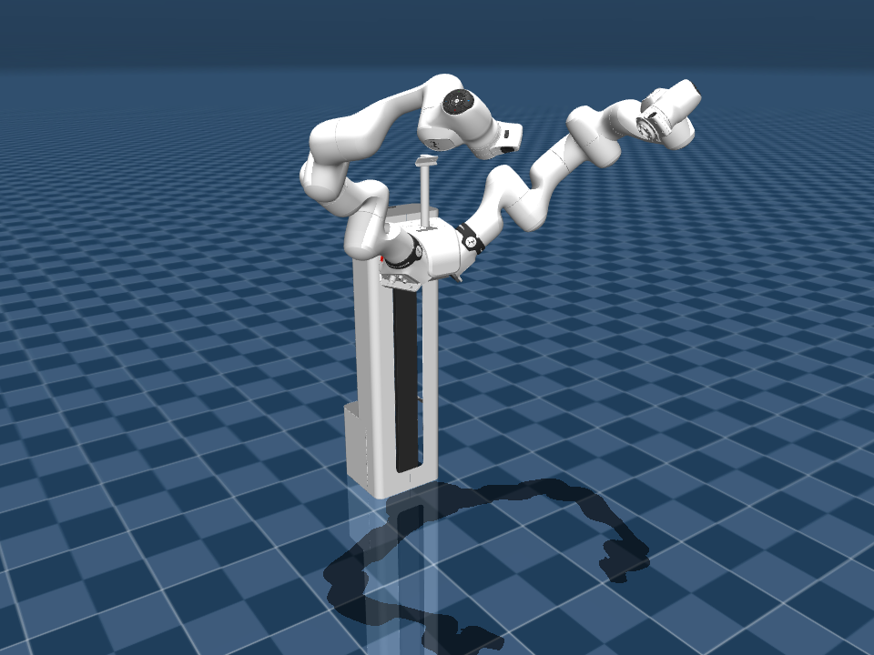

# Franka Robotics FR3 Duo Description (MJCF)

> [!IMPORTANT]
> Requires MuJoCo 3.1.3 or later.

## Changelog

See [CHANGELOG.md](./CHANGELOG.md) for a full history of changes.

## Overview

This package contains an MJCF model of the dual-arm
[Franka Research 3 Duo](https://franka.de/) (FR3 Duo) developed by
[Franka Robotics](https://franka.de/company). It comprises two Franka Research 3
(FR3 v2) 7-DOF arms mounted on a unified mounting base (`fr3_duo_mount_v0_3`)
with a center sensor head bracket (`franka_head_v0_2`), provided both in
tabletop form (`fr3_duo.xml`, `scene.xml`) and mounted on the
`franka_spine_v0_1` vertical column (`fr3_duo_with_spine.xml`,
`scene_with_spine.xml`).

The model is derived from the upstream
[frankarobotics/franka_description](https://github.com/frankarobotics/franka_description)
repository (version 2.9.0, commit `7aeeddc449edf8d62b594f9e36a81da53e7796f9`).

<p float="left">
  
  
</p>

## URDF → MJCF derivation steps

1. Expanded
   [`robots/fr3_duo/fr3_duo.urdf.xacro`](https://github.com/frankarobotics/franka_description/blob/main/robots/fr3_duo/fr3_duo.urdf.xacro)
   with `hand:=false` using `xacro` to generate the URDF (and similarly combined
   `accessories/franka_spine_v0_1/franka_spine.xacro` with
   `robots/fr3_duo/fr3_duo.xacro` for `fr3_duo_with_spine`).
2. Converted the mount, cover, head, and spine COLLADA (`.dae`) visual meshes to
   Wavefront OBJ (`.obj`) preserving vertex normals and applying the
   millimeter-to-meter (`0.001`) node transform, processed them with
   [`obj2mjcf`](https://github.com/kevinzakka/obj2mjcf) (splitting
   `franka_spine` into three material-grouped OBJs `franka_spine_{0,1,2}.obj`),
   and reused the visual (`.obj`) and collision (`.stl`) arm meshes from
   [`franka_fr3_v2`](https://github.com/google-deepmind/mujoco_menagerie/tree/main/franka_fr3_v2).
3. Added the `<mujoco>` compiler block below to each URDF's `<robot>` clause,
   loaded each URDF into MuJoCo, and saved the corresponding MJCFs so all link
   transforms, joint limits, and inertials come directly from MuJoCo's URDF
   converter:

   ```xml
   <mujoco>
     <compiler balanceinertia="true" discardvisual="true" fusestatic="false"
       strippath="false"/>
   </mujoco>
   ```
4. Edited the saved MJCFs to attach the multi-material `.obj` visual geoms
   (splitting visual `class="visual"` / `group="2"` and collision
   `class="collision"` / `group="3"` under `<default class="fr3_duo">`),
   collapsed fixed mounting-frame and empty accelerometer bodies while
   preserving their composed transforms, and set the `base` mounting offset:
   - In `fr3_duo.xml`, offset `base` to `z = 0.030814` so the bottom of
     `fr3_duo_mount` rests on `z = 0`.
   - In `fr3_duo_with_spine.xml`, kept the `accessories/franka_spine_v0_1`
     dimensions and `x = 0.266711` mounting offset from
     `frankarobotics/franka_description`, while fixing `z = 0.913887` (within
     the column's `0.1` + `[0, 0.85]` m vertical slide range) so the arms have
     sufficient clearance to interact with an ALOHA-style table in simulation.
5. Added `<contact>` `<exclude>` pairs from `robots/fr3_duo/fr3_duo.srdf.xacro`
   and `robots/mobile_fr3_duo_v0_2/mobile_fr3_duo_v0_2.srdf.xacro` (`base`
   against `{left,right}_fr3v2_link1`, plus `franka_spine` against `base`,
   `head_link`, and `{left,right}_fr3v2_link{0,1,2}` in
   `fr3_duo_with_spine.xml`), along with `head_camera` and
   `{left,right}_attachment_site` sites, `home` keyframes, and
   position-controlled actuators for all 14 joints (7 left, 7 right) matching
   [`franka_fr3_v2/fr3v2.xml`](https://github.com/google-deepmind/mujoco_menagerie/blob/main/franka_fr3_v2/fr3v2.xml).
6. Added `scene.xml` and `scene_with_spine.xml` with a textured ground plane,
   skybox, and lighting, and verified model loading and simulation stability
   with zero warnings.

## License

This model is released under an [Apache-2.0 License](LICENSE).
