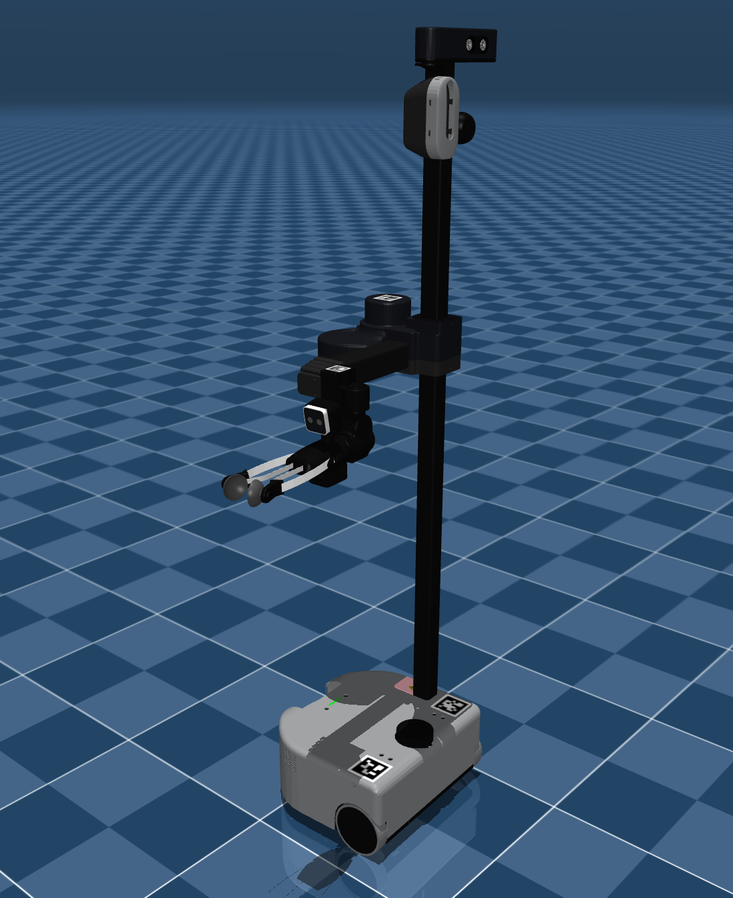

# Hello Robot Stretch 3 Description (MJCF)

> [!IMPORTANT]
> Requires MuJoCo 3.3.0 or later.

## Changelog

See [CHANGELOG.md](./CHANGELOG.md) for a full history of changes.

## Overview

This package contains the robot description (MJCF) of the [Hello Robot Stretch 3](https://hello-stretch3.com/) developed by [Hello Robot](https://hello-robot.com/). This model was directly provided by Hello Robot under the [Apache 2.0](LICENSE).

The next generation of the robot is available as [hello_robot_stretch_4](../hello_robot_stretch_4), and the previous one as [hello_robot_stretch](../hello_robot_stretch) (Stretch 2).

  

## URDF → MJCF derivation steps

1. Processed `.obj` files with [`obj2mjcf`](https://github.com/kevinzakka/obj2mjcf).
2. Added `<mujoco> <compiler discardvisual="false" fusestatic="false" balanceinertia="true"/> </mujoco>` to the URDF's
   `<robot>` clause in order to preserve visual geometries.
3. Loaded the URDF into MuJoCo and saved a corresponding MJCF.
4. Manually edited the MJCF to extract common properties into the `<default>` section.
5. Added actuators.
6. Added `<exclude>` clauses to prevent collisions in the telescoping arm.
7. Added `scene.xml` which includes the robot, with a textured groundplane, skybox, and haze.
8. Formatted the MJCF wiht XML formatter.

## License

This model is released under an [Apache-2.0 License](LICENSE).
