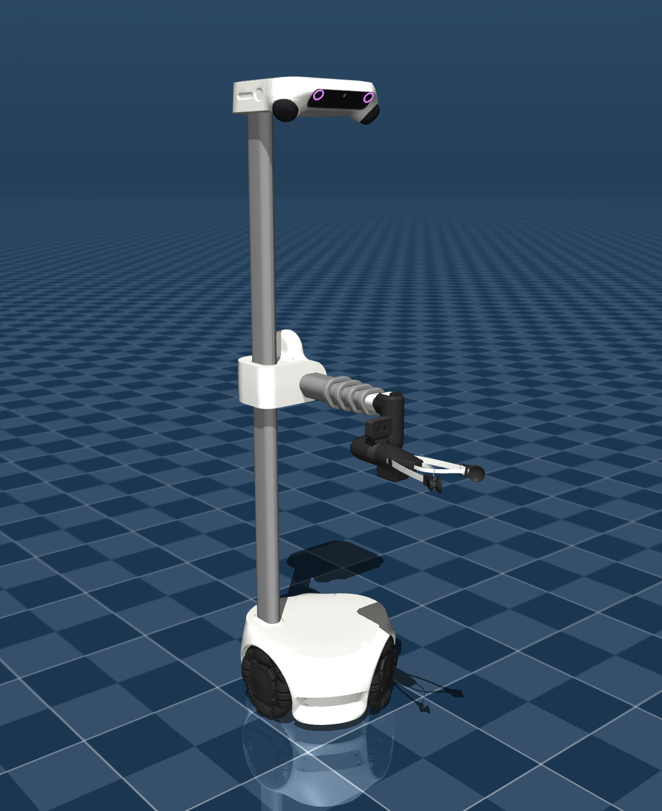
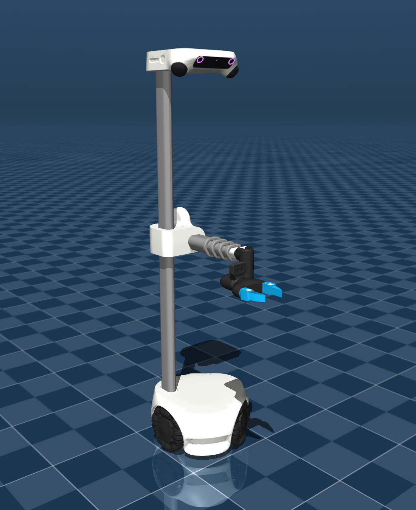

# Hello Robot Stretch 4 Description (MJCF)

> [!IMPORTANT]
> Requires MuJoCo 3.3.0 or later.

## Changelog

See [CHANGELOG.md](./CHANGELOG.md) for a full history of changes.

## Overview

This package contains the robot description (MJCF) of the
[Hello Robot Stretch 4](https://hello-robot.com/product) developed by
[Hello Robot](https://hello-robot.com/). This model was directly provided by
Hello Robot under the [Clear BSD License](LICENSE).

Stretch 4 is a mobile manipulator with a telescoping arm and an omnidirectional base. The robot's sensor suite has been improved to enhance navigation and manipulation capabilties around people and in cluttered environments.

The previous generations are available on the Menagerie at
[hello_robot_stretch_3](../hello_robot_stretch_3) and
[hello_robot_stretch](../hello_robot_stretch) (Stretch 2).

<p float="left">
  
  
</p>

<p><em>Left: the SG4 standard gripper. Right: the PG4 parallel jaw gripper.

## Gripper variants

Stretch 4's wrist ends in a quick-connect interface, so the tool is swappable.
Two are modeled here, each with its own scene:

| | SG4, the standard gripper | PG4, the parallel jaw gripper |
|---|---|---|
| Robot MJCF | [`stretch4.xml`](stretch4.xml) | [`stretch4_pg4.xml`](stretch4_pg4.xml) |
| Scene | [`scene.xml`](scene.xml) | [`scene_pg4.xml`](scene_pg4.xml) |
| Description | Compliant two-finger gripper with suction-cup fingertips and ArUco fiducials on the fingertips. | Parallel jaw gripper for precise manipulation and secure grasping of rigid objects. |
| Finger joints | Revolute, plus a two-axis compliant fingertip | Prismatic |

Both variants expose the same ten actuators, in the same order, so a controller
written against one works against the other:

| Actuator | Type | Notes |
|---|---|---|
| `back_wheel_vel`, `right_wheel_vel`, `left_wheel_vel` | velocity | Omnidirectional base |
| `lift` | position | Vertical lift, 0–1.2 m |
| `arm` | position | Telescoping arm, 0–0.52 m, driven through the `extend` tendon |
| `wrist_yaw`, `wrist_pitch`, `wrist_roll` | position | 3-DoF dexterous wrist |
| `gripper_right_finger`, `gripper_left_finger` | position | Finger range depends on the tool: `0`–`0.5` rad on SG4, `-0.04`–`0` m on PG4 |

Two keyframes, `home` and `stow`, are provided in both variants.

## Sensors

Stretch 4 carries five cameras, two hemispherical lidars, six line sensors and
an IMU.

The MJCF provides the sites and frames for the sensors, and [`stretch4_sensors.py`](stretch4_sensors.py) provides the
sensor models.

Note: Two of the cameras are 180-degree fisheye lenses, [stretch4_mujoco](https://github.com/hello-robot/stretch4_mujoco) models them by rendering three cameras for each to get the 180-degree FOV, then apply the fisheye distortion.

The calibration values, the sensor models and the helpers in
`stretch4_sensors.py` are ported from
[`stretch4_mujoco`](https://github.com/hello-robot/stretch4_mujoco). They come from its `enums/stretch_cameras.py`,
`fisheye_renderer.py`, `enums/line_sensor.py`,
`mujoco_server_sensor_manager.py` and `models/stretch_4/lidar_calibration.csv`,
and produce the same images, point clouds and line sensor readings on this
model.

### Cameras

| MJCF camera | Resolution | Rate | Upright |
|---|---|---|---|
| `camera_left_link` | fisheye, 1920×1200 | 30 Hz | `np.rot90(k=1)` |
| `camera_right_link` | fisheye, 1920×1200 | 30 Hz | `np.rot90(k=-1)` |
| `camera_center_link` | 4034×3040| 10 Hz | `np.rot90(k=-1)` |
| `gripper_camera_left_rgb` | 640×400| 30 Hz | – |
| `gripper_camera_right_rgb` | 640×400 | 30 Hz | – |
| `gripper_camera_stereo_depth` | 640×400 | 30 Hz | – |

- **Orientation.** The three head sensors are mounted on their side, so their
  frames come out sideways. The "Upright" column is the rotation that stands
  them up (`Stretch4Camera.render(data, upright=True)`). Note: K and the distortion
  coefficients describe the frame before that rotation, apply them before transforming the image.
- **Offscreen buffer.** MuJoCo's default offscreen buffer is 640×480, which is
  too small for the head cameras. Raise `model.vis.global_.offwidth` and
  `offheight` before creating a `mujoco.Renderer`. `Stretch4Camera` does this
  for you.
- **Head left and right (fisheye).** `Stretch4Camera` renders three
  pinhole views fanned across the frame, then remaps them through the
  Kannala-Brandt model (OpenCV's `fisheye` module, ROS's `equidistant`).

### Head lidars

Each hemispherical lidar has 128 channels. Each channel has a calibrated
elevation, from −4.3° to 89.1° above the site's xy plane, and an azimuth
offset around the site's z axis. These come from a real unit and are listed in
`stretch4_sensors.LIDAR_CHANNELS`. `Stretch4Lidars` fires all 128 channels at
250 azimuths per revolution, 32,000 rays per lidar, out to 30 m, with
`mujoco.mj_multiRay` from the `lidar_left` and `lidar_right` sites.

### Line sensors

`Stretch4LineSensors` casts 320 bins per sensor across a 103° fan in the
site's xy plane. Bin 0 is the +y (left) edge. Like the real sensor, a bin
reports depth along the boresight rather than ray length, so a flat floor
reads the same ~0.2297 m in every bin. Each call returns three arrays, all
indexed `[sensor, bin]`:

- `ranges`: depth in metres, NaN where the bin holds a status code instead.
- `codes`: a `LineSensorCode`. `valid`; `beyond_limit` for a return past 1 m,
  which the robot reports as 5.09 (the floor dropped away); `no_return` when
  nothing reflected, reported as 5.11.
- `points`: where each bin hit, in the robot frame.

The sensors see the scene and the robot, a lowered gripper for example, but
not the base shell they are mounted on.

### Usage

```python
import mujoco
from stretch4_sensors import Stretch4Camera, Stretch4Lidars, Stretch4LineSensors

model = mujoco.MjModel.from_xml_path("scene.xml")
data = mujoco.MjData(model)
mujoco.mj_forward(model, data)

with Stretch4Camera(model, "camera_left_link") as camera:
  fisheye = camera.render(data)                # (1200, 1920, 3), sideways
  upright = camera.render(data, upright=True)  # (1920, 1200, 3)

with Stretch4Camera(model, "gripper_camera_stereo_depth") as camera:
  depth = camera.render(data)  # (400, 640) metres, 0 past 1 m

clouds = Stretch4Lidars(model).trace(data)  # {"left": (N, 3), "right": (M, 3)}
ranges, codes, points = Stretch4LineSensors(model).trace(data)
```

Create each `Stretch4Camera`, `Stretch4Lidars` and `Stretch4LineSensors` once
and call `render` or `trace` every frame. Setting them up precomputes the
fisheye maps and the ray tables.

#### Example: keyboard_teleop.py

[`keyboard_teleop.py`](keyboard_teleop.py) puts it together. It opens
`scene.xml` (or `scene_pg4.xml` with `--pg4`) in the MuJoCo viewer, drives the
robot from the keyboard, and streams every camera, both lidar clouds and the
line sensor hits to [Rerun](https://rerun.io) at 10 Hz. It is a single-file
port of `stretch4_mujoco`'s `examples/keyboard_teleop.py` with the same key
bindings, and needs `pynput` and `rerun-sdk` as well.

```sh
python keyboard_teleop.py
```

## License

This model is released under a [Clear BSD License](LICENSE).
