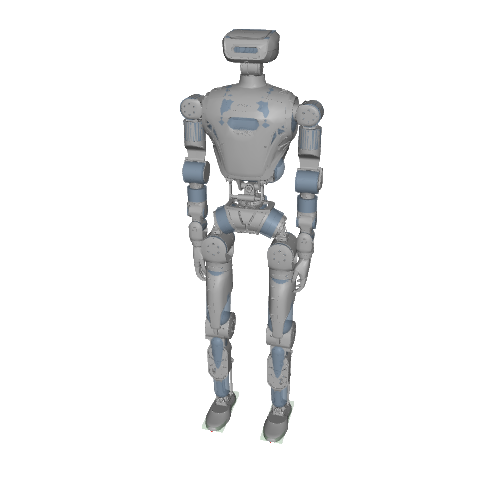

# LimX Oli Description (MJCF)

> [!IMPORTANT]
> Requires MuJoCo 3.0 or later.

## Changelog

See [CHANGELOG.md](./CHANGELOG.md) for a full history of changes.

## Overview

This package contains a robot description (MJCF) of the [Oli humanoid
robot](https://www.limxdynamics.com/) (HU_D04) developed by [LimX
Dynamics](https://www.limxdynamics.com/). It is derived from the [publicly
available MJCF description](https://github.com/limxdynamics/humanoid-description/blob/4c0a3c71200b810a52831c7c2b2de0ed6ce819a4/HU_D04_description/xml/HU_D04_01.xml) in
[humanoid-description](https://github.com/limxdynamics/humanoid-description) at commit
`4c0a3c7`.

  

## MJCF derivation steps

LimX publishes an MJCF for this robot alongside its URDF, and the MJCF is the
more faithful of the two: it models the parallel-linkage ankles and waist as
closed loops, which the URDF approximates as serial joints. This model is
therefore derived from the upstream MJCF rather than converted from the URDF.
All link masses, inertias, body frames, joint axes, ranges, armature and
damping are taken unchanged from upstream; the compiled kinematic tree and
mass properties match the upstream file exactly.

1. Copied `HU_D04_description/xml/HU_D04_01.xml` and the meshes it references from
   [humanoid-description](https://github.com/limxdynamics/humanoid-description) at commit
   `4c0a3c7`, and pointed `meshdir` at `assets/`.
2. Moved the floor and light into `scene.xml`, and removed the tracking
   camera, skybox, `<visual>` and `<size>` settings from the model file.
3. Moved the shared joint and geom properties into a `oli` default class with
   `visual` and `collision` sub-classes.
4. Replaced the upstream torque motors with position actuators, keeping the
   upstream torque limits as `forcerange`.
5. Removed two `<exclude>` pairs between the floating base and the hip pitch
   links, which MuJoCo already filters as parent and child.
6. Added `<exclude>` pairs between each hand (wrist_roll) link and the
   hip_pitch and hip_yaw links of the same side (see Notes).
7. Added a `home` keyframe.
8. Formatted the XML with `format_xml.py`.

## Notes

- Oli's ankles and waist are driven through parallel linkages. They
  are modelled as closed loops with `equality` constraints, and the actuators
  drive the motor-side joints (`*_A_*`, `*_B_*` and `waist_A/B`), as on the real
  robot. The gripper and dexterous-hand variants of HU_D04 are not included here; see
[humanoid-description](https://github.com/limxdynamics/humanoid-description)
for those.
- The position actuator gains are not system-identified. They were chosen so
  that the robot holds the `home` keyframe without a controller (kp: legs
  500, ankle motors 300, waist 300, arms 60, head and wrists 20; `dampratio="1"`).
- With the arms hanging at the zero pose, the convex hull of the hand mesh
  overlaps the hip collision geometry by a few millimetres, although the parts
  do not touch on the robot. The affected same-side hand/hip pairs are excluded
  from collision.

## License

This model is released under an [Apache-2.0 License](LICENSE).
