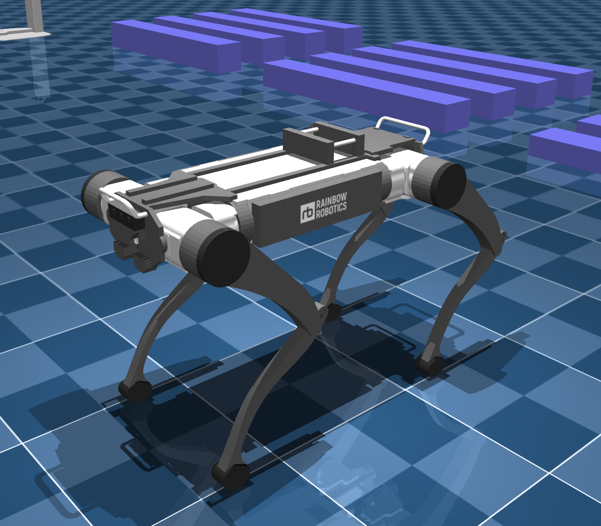

# Rainbow Robotics RBQ-10 Description (MJCF)

> [!IMPORTANT]
> Requires MuJoCo 3.2.0 or later.

## Changelog

See [CHANGELOG.md](./CHANGELOG.md) for a full history of changes.

## Overview

This package contains a robot description (MJCF) of the [RBQ-10](https://rainbowrobotics.github.io/RBQ/)
quadruped developed by [Rainbow Robotics](https://www.rainbow-robotics.com/). It is derived from the
MJCF model that ships with the [RBQ software package](https://github.com/RainbowRobotics/RBQ/tree/main/resources/model),
which Rainbow Robotics uses for its own simulator.

  

## Model notes

1. Body masses and joint limits are the values the RBQ-10 controller uses (trunk 16.758 kg, total 40.68 kg).
2. The twelve leg joints are driven by torque (`motor`) actuators, limited to ±100 Nm (abduction, hip) and
   ±150 Nm (knee). This matches the real robot, whose motor drives close the loop themselves:
   `tau = kp * (q_ref - q) + kd * (dq_ref - dq) + tau_ff`, with gains set per motion by the host. Run the same
   PD law in your controller and write the result to `ctrl`.
3. The limits are static. The real drives also derate torque with joint speed, which is not modeled here.
4. Rotor inertia is modeled with `armature`, and joint friction with `frictionloss`.
5. Collisions use a trunk mesh, primitives on the legs, and spheres on the feet. Foot contacts have higher
   friction and priority, and `impratio` is raised to reduce slipping.
6. The base has a `<freejoint/>`. Six body-fixed cameras (`BT0`–`BT3`, `FT0`, `RR0`) and joint position
   sensors are included.
7. `scene.xml` includes the robot, with a textured groundplane, skybox, and haze.

## License

This model is released under the [Apache-2.0 License](LICENSE).
