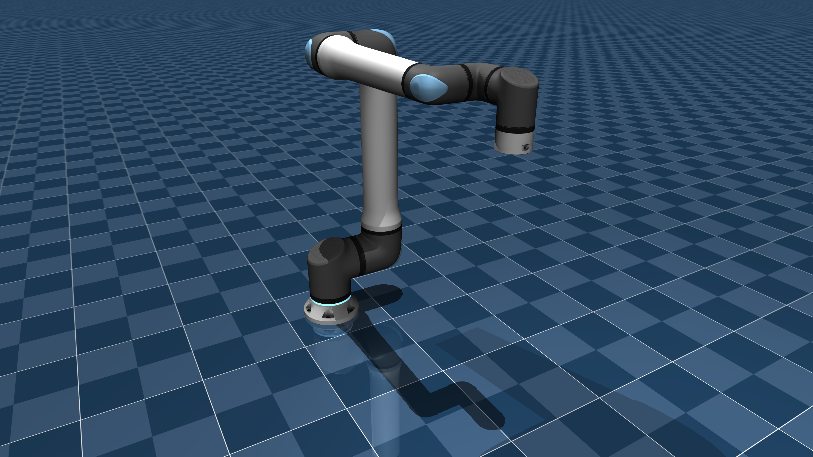

# Universal Robots UR20 Description (MJCF)

> [!IMPORTANT]
> Requires MuJoCo 2.3.3 or later.

## Changelog

See [CHANGELOG.md](./CHANGELOG.md) for a full history of changes.

## Overview

This package contains a simplified robot description (MJCF) of the
[UR20](https://www.universal-robots.com/products/ur20-1750/) developed by
[Universal Robots](https://www.universal-robots.com/). It is derived from the
[publicly available URDF description](https://github.com/UniversalRobots/Universal_Robots_ROS2_Description) (version 4.4.0).

  

© 2023 Universal Robots A/S. Use hereof is subject to Universal Robots A/S’ Terms and Conditions for Use of Graphical Documentation.

### URDF → MJCF derivation steps

1. Generated the URDF from the xacro description with `ur_type:=ur20`.
2. Converted the DAE [mesh files](https://github.com/UniversalRobots/Universal_Robots_ROS2_Description/tree/4.4.0/meshes) to OBJ format, keeping the diffuse texture
   of the description (stored as PNG). Each part (housings, tubes, caps, seals) has its own material
   that tints the texture to the colors of the Menagerie UR5e and UR10e models.
   The status light ring of the base is a separate, emissive part.
   The vertex normals are recomputed and coarse curved surfaces are subdivided, so that the meshes
   shade smoothly. Seal rings that the meshes model flush with the housing are raised by 0.3 mm, so
   that the housing does not show through their edges.
3. Used the same body frames as the Menagerie UR5e and UR10e models, so that joint angles, the `home`
   keyframe and the `attachment_site` have the same meaning for all Universal Robots models.
4. Copied the inertial parameters from the URDF.
5. Added a tracking light to the base.
6. Extracted common properties into the `<default>` section.
7. Added position-controlled actuators. Force limits are the maximum joint torques of the URDF. The gains
   are computed from the dynamics of the model: the stiffness keeps the error under gravity below
   0.005 rad in every configuration and reaches the torque limit at 0.05 rad, and the
   damping is the lowest for which 0.5 rad steps from the home pose overshoot by less than 2%.
   The armature is 0.1, as in the UR5e and UR10e models. These values are not identified on a real
   robot -- contributions are more than welcome to improve them.
8. Added home joint configuration as a `keyframe`.
9. Designed collision geometries with capsules (and a cylinder for the tool flange) that follow the shape
   of each link.
10. Added `scene.xml`, which includes the robot, with a textured ground plane, skybox, and haze.

## License

The MJCF description is released under a [BSD-3-Clause License](LICENSE). The mesh and texture files in
`assets/` are Graphical Documentation of Universal Robots A/S and are subject to the
Terms and Conditions for Use of Graphical Documentation, which follow the BSD-3-Clause License in
[LICENSE](LICENSE).
